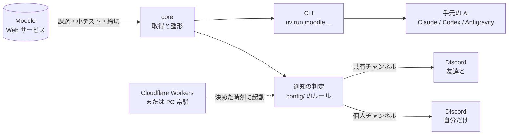

# kadai-sentinel


**課題の見張り番。** Moodle の課題・小テストと締切を Discord に知らせ、手元の AI からも Moodle の情報を読めるようにするツールです。


公開期間の短い小テストや課題の締切を見逃さないこと、締切を友達と共有すること、配布資料を手元の AI で復習に使うこと。この 3 つのために作りました。特定の大学向けではなく、Moodle を使っている大学・学校なら `.env` の URL を変えるだけで使えます。

## 特徴

- **見逃さない通知**:新しい課題、締切の変更、締切前のリマインド、小テストが公開されたらすぐに知らせる通知
- **授業ごとにルールを決められる**:何を・いつ知らせるかを `config/courses/授業ID.json` に書くだけ(「1 週間前と前日」「締切日の 16:30」なども可)
- **共有と個人を分ける**:友達との共有チャンネルには授業の情報だけを流し、自分の提出状況は自分専用のチャンネルにだけ届く
- **大学のサーバーに負担をかけない**:Moodle を確認するのはふだん 1 日 2 回。短い小テストがある時間帯だけ 1 分おき
- **24 時間・無料**:Cloudflare Workers の無料枠で動く。PC を閉じていても届く
- **AI から使える**:Claude Code・Codex CLI・Antigravity(Gemini)などが `AGENTS.md` を読んで、そのまま使える
- **読み取り専用**:Moodle には何も書き込みません
- **Moodle 標準の仕組みだけを使う**:公式の Moodle モバイルアプリと同じ Web サービス API を、自分のアカウントの権限の範囲で読むだけです

## 仕組み



## 通知の例

```
🚨 小テストが公開されました                     ← 赤色・単独で投稿
第3回授業小テスト
授業  〇〇概論
受付  10/15(木) 14:35〜14:44   残り あと 9 分   制限時間 4 分

⏰ 締切まで1日を切りました
レポート1
授業  〇〇演習
締切  11/06(金) 23:59
```

## クイックスタート

```bash
uv sync
cp .env.example .env            # MOODLE_URL を自分の大学のものに
uv run moodle diagnose          # ログイン方式を調べる
uv run moodle login --sso       # SSO の大学の場合(ID とパスワードで入る大学は --sso を付けない)
uv run moodle tasks             # やること一覧が出れば OK
```

パスワードは保存しません。トークンだけが `.env` に入ります。

SSO(学認・Microsoft アカウントなど)でログインする大学では、公式の Moodle モバイルアプリと同じ手順でトークンを受け取ります。詳しくは [docs/LOGIN.md](docs/LOGIN.md) を見てください。

## 使う前に確認すること

- 大学の Moodle で、モバイルアプリ用の Web サービスが有効になっていること(`uv run moodle diagnose` で分かります)
- 大学の情報システムの利用規約で、モバイルアプリ以外からの利用が禁止されていないこと。分からなければ大学の窓口に確認してください

## コマンド

| コマンド | 内容 |
| --- | --- |
| `uv run moodle tasks` | やること一覧(`--url` でリンク、`--json` で機械向け) |
| `uv run moodle courses` | 履修中の授業と授業 ID |
| `uv run moodle assign 課題名` | 課題の設定と自分の提出状況 |
| `uv run moodle files` | 配布資料を `materials/` に取得(更新分だけ) |
| `uv run moodle notify --test personal` | Discord 通知の見た目を確認 |

## AI とつなぐ

| 使っている AI | つなぎ方 |
| --- | --- |
| Claude Code / Codex CLI | このフォルダで起動するだけ。AI が `AGENTS.md` を読んでコマンドを使う |
| Gemini(Antigravity のアプリ・`agy`) | このフォルダを開くだけ。AI が `GEMINI.md` と `AGENTS.md` を読む(Gemini CLI は 2026 年 6 月に終了) |
| Claude デスクトップアプリ | このフォルダをチャットに接続すると、スマホからでも頼める |
| その他 | `uv run moodle tasks --json` の結果や資料を貼り付ける |

「今週の締切は?」「〇〇の第 2 回の資料を要約して」のように頼めます。

## Discord 通知

1. Discord のチャンネル設定 →「連携サービス」→「ウェブフック」で URL を作り、`.env` に書く(共有用 `DISCORD_WEBHOOK_URL`、自分用 `PERSONAL_WEBHOOK_URL`)
2. 授業ごとのルールを `config/` に書く(`uv run moodle config add-course 授業ID` でひな形ができる。例は `examples/config/`)
   - 書ける項目と書き方は [docs/CUSTOMIZE.md](docs/CUSTOMIZE.md)。書いたら `uv run moodle config check`
   - 設定ではできないこと(文面を変えるなど)は `custom/` に自分用のコードを置ける([docs/EXTEND.md](docs/EXTEND.md))
   - `config/` と `custom/` は Git に入らないので、本体を更新してもぶつからない。昔の `notify.toml` もそのまま使える

### Cloudflare Workers で 24 時間動かす(無料)

```bash
cd worker
npm install
npx wrangler login
cp wrangler.example.toml wrangler.toml
npx wrangler kv namespace create STATE    # 表示された id を wrangler.toml に書く
npm run deploy                            # 設定をまとめてからデプロイする
npm run secrets                           # .env の値を Cloudflare に登録(画面には出ない)
```

1 分おきに起動しますが、Moodle を確認するのは決めた時刻だけで、それ以外はすぐ終わります(無料枠の約 1.4%)。設定を変えたら `npm run deploy` で反映します(設定に誤りがあればデプロイせずに止まります。`npx wrangler deploy` を直接使うと設定が反映されません)。

通知は Cloudflare 版だけで動きます(PC で常駐させる版は 1.0.0 で終わりました。理由は [CHANGELOG.md](CHANGELOG.md))。

## 更新するとき

```bash
git pull
uv run moodle whatsnew     # 何が変わったか・更新したらやること
```

変更の記録は [CHANGELOG.md](CHANGELOG.md)。本体を直す人は、変える前と後に `cd worker` → `npm test` で、通知の届き方が壊れていないかを確かめてください。

## 設計

考え方や判断の理由は [docs/DESIGN.md](docs/DESIGN.md) にまとめています。

## 注意

- 使う前に、自分の大学の情報システム利用規約を確認してください。このツールは大学・Moodle 公式とは関係ありません(Moodle は Moodle Pty Ltd の商標です)
- トークンはパスワードと同じです。`.env` を人に渡したりコミットしたりしないでください
- 授業資料の著作権は担当の先生にあります。履修していない人に共有しないでください
- 確認の間隔を短くしすぎないでください(1 分おきは本当に必要な時間帯だけ。上限も設けています)
- 課題に AI を使うかどうかは、授業ごとのルールに従ってください

## ライセンス

[MIT](LICENSE)
